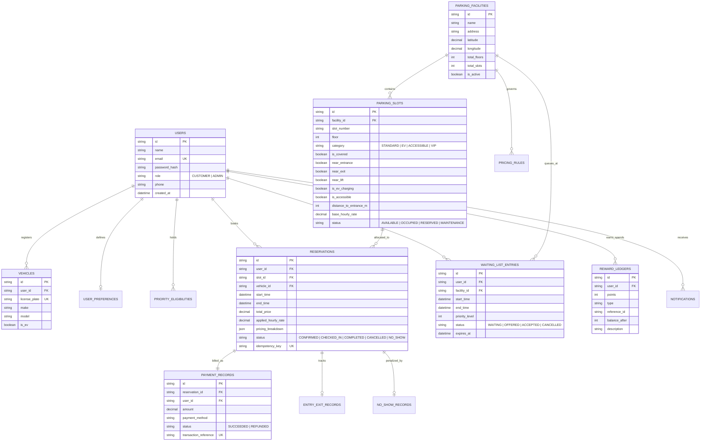

# 3. ENTITY-RELATIONSHIP (ER) DIAGRAM & RELATIONAL SCHEMA

## 3.1 Mermaid ER Diagram

## 3.2 Relational Integrity & Normalization (3NF)
1. **First Normal Form (1NF):** All table attributes contain atomic values. Composite attributes such as names, coordinates, and intervals are separated into discrete, non-repeating columns.
2. **Second Normal Form (2NF):** Every non-key attribute is fully functionally dependent on the entire primary key. In tables with composite unique keys (e.g., `facility_id, slot_number`), attributes like `floor`, `category`, and `is_covered` depend on the unique slot identity, not subsets.
3. **Third Normal Form (3NF):** No transitive dependencies exist. Facility address and coordinates belong strictly to `parking_facilities`; slots reference only `facility_id`. User reward balances are dynamically reconciled from immutable ledger records rather than stored as redundant, mutable duplicate fields.
